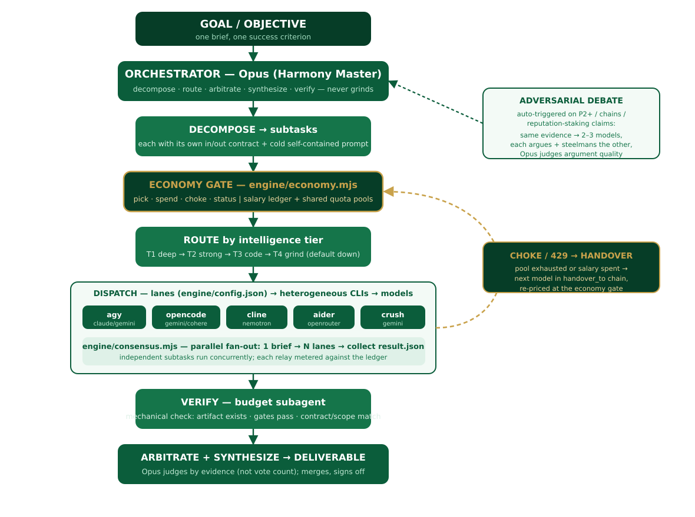

<p align="center">
  
</p>

<p align="center"><em>When Persephone rises, the dead ground turns green again.</em></p>

In the myth, Demeter's grief for her daughter freezes the world while Persephone is held in the underworld, and her return each spring brings it back to life. HGR is built around that turn from dormancy to life. Models go cold when a quota is spent, a provider goes dark when it rate-limits, and the work would stall there. The orchestrator is the return: it wakes another model, reroutes the task, and keeps the season turning.

HGR (Heterogeneous Generative Reasoning) is an orchestration layer. One high-capability orchestrator model (the "Harmony Master") takes a goal, splits it into subtasks, and routes each subtask to the cheapest model that can do it. It spreads work across several different coding-agent CLIs and model providers. A small economy meters spend against real provider quotas so a run cannot silently drain a shared pool. Independent subtasks can be fanned out in parallel, and critical judgments can be sent to several models to debate. The orchestrator verifies, arbitrates between answers by evidence, and synthesizes the result. The orchestrator routes and judges. It does not do the grind work itself.

The current flow is as follows: pre-dispatch auto-routing (route.mjs refreshes pool_status and substitutes away from dead pools), the salary+handover mission driver (mission.mjs), the critical-file guard (guard.mjs), and that dispatched models run real tools rather than simulate.

## What it is

A framework for decomposing a task into subtasks, routing each subtask to a generative model across many CLIs and providers, metering the spend, and arbitrating the results. The name reads as heterogeneous (many different models and CLIs), generative (they generate the work), reasoning (the orchestrator reasons about decomposition, routing, and arbitration).

## Why heterogeneous

Different models have different costs, capabilities, and quotas. Like the seasons, no single provider is in season all year. A heterogeneous fleet does more work, cheaper, than a single model, and keeps running when any one provider is rate-limited. When a pool is exhausted the economy hands the subtask to the next model in a fallback chain instead of stalling.

## Persephone's return

HGR takes its name and its mark from the myth. Persephone spends part of the year in the underworld, where nothing grows, and part above, where everything does. The system lives the same cycle. A model pool falls dormant when its quota is spent or a provider rate-limits it, which is the husk in the logo and Persephone's descent. The orchestrator is the return: it reroutes a choked model to the next in its chain, wakes a different provider, and keeps the task moving so nothing that looked dead stays dead. The bloom rising from the husk is a subtask that had stalled and is now running again on another model.

The mark carries one idea above all: something that once felt lifeless can become meaningful again. Each part of the system maps to a part of the myth:

| Myth | System |
| --- | --- |
| Descent into the underworld | A pool is choked by a 429 or a spent quota |
| The return, spring over winter | Handover to the next model in the chain |
| The turning seasons | The economy tracking which pools are dormant and which are in season |
| Many voices at the gate | Consensus fanning one brief out to many models in parallel |
| Judgment among the shades | Debate, where several models argue and the orchestrator judges |
| What truly came back | Verification confirming the result is real and not a hollow claim |

## The cycle (architecture)

<p align="center">
  
</p>

1. The orchestrator takes a goal and decomposes it into subtasks, each with its own input/output contract and a cold, self-contained prompt.
2. The economy gate meters each subtask against a salary ledger and shared quota pools.
3. The router assigns each subtask to the cheapest model that can do it, defaulting down the tier chain.
4. The dispatcher sends the subtasks to the implementer CLIs, running independent ones in parallel.
5. The verifier (a cheap budget subagent) checks that each subtask produced its contracted output.
6. The orchestrator arbitrates between answers by evidence, not vote count, and synthesizes the result.

On a 429 or an exhausted pool, the model is choked and the subtask hands over to the next model in its `handover_to` chain, re-priced at the economy gate. This is the descent and the return in one step: the cold model is left below, and the work comes back up on a living one. Reputation-staking judgments (severity calls, multi-step chains, anything that ships) are sent to two or three models that argue and steelman each other, and the orchestrator judges the argument quality.

## Quickstart

For a step-by-step setup, see [docs/INSTALLATION.md](docs/INSTALLATION.md).

Install Node 18+, then the CLIs you want in the fleet (opencode, aider, cline, agy, kilo). Point the engine at its config directory with `CONFIG_DIR` (default `/home/kali/.config/delegate-skills`). Then:

```
node engine/mission.mjs --brief brief.json --role deep --mission demo
node engine/route.mjs --json
node engine/economy.mjs pick   --role deep --mission demo
node engine/consensus.mjs --brief brief.txt --lanes patch,tests,fast --mission demo
```

## Install the CLIs

Install only the ones you plan to route to. Each is an independent implementer.

### opencode
`npm i -g opencode-ai` then `opencode auth login`. Needs Node 18+.

### aider
`python -m pip install aider-chat` (or pipx). It authenticates with a provider key in the environment (`OPENAI_API_KEY`, `ANTHROPIC_API_KEY`, `OPENROUTER_API_KEY`, `COHERE_API_KEY`, and so on). It can also drive a local OpenAI-compatible endpoint with `--api-base` plus a non-empty `OPENAI_API_KEY`. Several provider keys in the aider env file drive zero-dollar free lanes: OpenRouter free models, the NVIDIA NIM free dev tier (lanes aider-nim and aider-nim-code), and the SambaNova free tier (lanes aider-sn and aider-sn-code, rate limited).

### cline
Install the Cline CLI (npm package or bundled binary), then `cline auth`. Needs Node 18+.

### agy (Google Antigravity CLI)
Install from the Antigravity CLI docs and complete first-launch auth, then verify with `agy help`. It has its own metered quota.

### kilo (Kilo Code CLI)
Install with `npm i -g @kilocode/cli`, then `kilo auth login`. Needs Node 18+. Kilo is a fork of opencode and shares its command set. It authenticates through its own login and does not use environment API keys (only aider uses environment keys). Use its free models (for example `kilo/kilo-auto/free`); the `kilo/~...-latest` hosted aliases need paid Kilo Gateway credits.

## Wire them to the orchestrator

Each lane in `engine/config.json` binds a lane name to one implementer CLI and one model:

```json
"deep-free": { "implementer": "opencode", "model": "google/gemini-3.1-pro-preview" }
```

The `*-delegate` skills each provide a `scripts/relay.mjs`, which is what `consensus.mjs` spawns per lane. The economy reads `engine/models.json` for salaries and pool limits. Point the engine at its config directory with `CONFIG_DIR` (default `/home/kali/.config/delegate-skills`). To add a CLI to the fleet, add a lane for it in `config.json` and an entry in `models.json` with its intelligence, salary, quota pool, and handover chain.

## The economy (the seasons)

The economy is the calendar of the fleet. It knows which pools are in season and which are below ground, and it never sends work to a field that cannot grow it. Models are grouped into four tiers: T1 deep, T2 strong, T3 code, T4 grind, each mapped to a role. Every model has a salary (the number of dispatches it gets before handover) and a quota pool (the real provider limit it shares with other CLIs on the same key). The economy gate meters spend against both. `pick` returns the best eligible model for a role (highest intelligence, free first, smallest pool, as a tie-break), `spend` records a dispatch, `choke` marks a model (or a whole pool) spent and names its handover, and `status` prints what is left. A 429 or a hit pool limit triggers a choke, which hands the work to the next model in the `handover_to` chain.

## Consensus and debate (the chorus)

No single voice is trusted with a judgment that matters. `engine/consensus.mjs` fans one brief out to N lanes in parallel, collects each lane's `result.json`, and writes one combined `consensus.json`. Each dispatch is metered against the ledger so a fan-out cannot drain a shared pool unseen. For a reputation-staking judgment, send the same evidence to several lanes, have each argue a position and steelman the other, and judge the argument quality rather than counting votes.

## File reference

Full detail, including every function and CLI command, is in [docs/FILE_REFERENCE.md](docs/FILE_REFERENCE.md).

| File | What it is |
| --- | --- |
| [engine/config.json](docs/FILE_REFERENCE.md#engineconfigjson) | The lane map: lane name to implementer CLI and model. |
| [engine/economy.mjs](docs/FILE_REFERENCE.md#engineeconomymjs) | The salary and quota ledger CLI (pick, spend, choke, status). |
| [engine/route.mjs](docs/FILE_REFERENCE.md#enginemodelsjson) | Pre-dispatch auto-routing: refreshes pool_status, picks best-UP per role, substitutes dead pools. |
| [engine/mission.mjs](docs/FILE_REFERENCE.md#enginefree_modelsjson) | Drives salary + handover. |
| [engine/guard.mjs](docs/FILE_REFERENCE.md#enginepool_statusjson) | The critical-file guard: restores models.json/config.json if a dispatch mutates them. |
| [engine/consensus.mjs](docs/FILE_REFERENCE.md#engineconsensusmjs) | The parallel fan-out engine over fleet lanes. |
| [engine/infer.mjs](docs/FILE_REFERENCE.md#engineledgertemplatejson) | Dispatched models run real tools rather than simulate. |
| [engine/economy.test.mjs](docs/FILE_REFERENCE.md#engineeconomytestmjs) | Tests for the economy. |
| [engine/models.json](docs/FILE_REFERENCE.md#enginemodelsjson) | Model intelligence and salary database, with quota pools and tiers. |
| [engine/free_models.json](docs/FILE_REFERENCE.md#enginefree_modelsjson) | Wider roster of free models by pool. |
| [engine/pool_status.json](docs/FILE_REFERENCE.md#enginepool_statusjson) | Point-in-time snapshot of each pool's live status. |
| [engine/ledger.template.json](docs/FILE_REFERENCE.md#engineledgertemplatejson) | Per-mission ledger template. |
| [engine/RULES-token-thrift.md](docs/FILE_REFERENCE.md#enginerules-token-thriftmd) | Output contract every delegated implementer follows. |

## Usage examples

```
node engine/economy.mjs pick   --role deep --mission demo
node engine/economy.mjs spend  --role code --mission demo
node engine/economy.mjs choke  --model agy/claude-sonnet-4-6 --mission demo --why 429 --pool
node engine/economy.mjs status --mission demo
node engine/consensus.mjs --brief brief.txt --lanes patch,tests,fast --mission demo
```

## Limitations

- `consensus.mjs` currently hardcodes the config path (`/home/kali/.config/delegate-skills`) and the `~/.claude/skills` relay path. `economy.mjs` defaults the same path but honors `CONFIG_DIR`, `MODELS_FILE`, and `TEMPLATE_FILE`. Make the consensus paths configurable before running it elsewhere.
- `pool_status.json` and `free_models.json` are snapshots. They record what was true when written, not live state. Re-check a provider before trusting its listed status.
- Salaries and pool limits in `models.json` are calibrated from observed quota. They need re-calibration per account and over time.

## Acknowledgements

The delegate and debate skills that HGR is built on come from nagdy ([amElnagdy](https://github.com/amElnagdy)):

- Delegate skills: [amElnagdy/delegate-skills](https://github.com/amElnagdy/delegate-skills)
- Debate review: [amElnagdy/review-skills](https://github.com/amElnagdy/review-skills)

## License

MIT. See [LICENSE](LICENSE).
